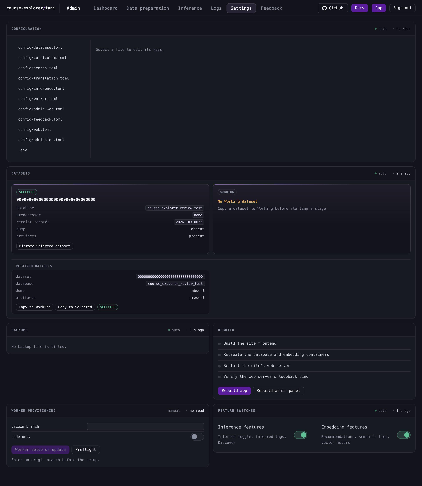
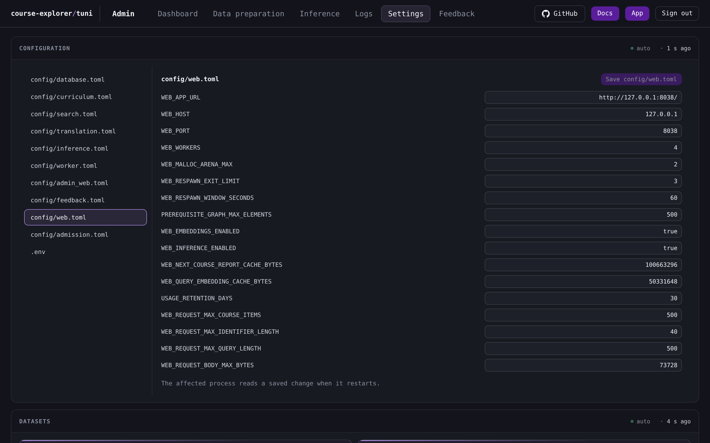
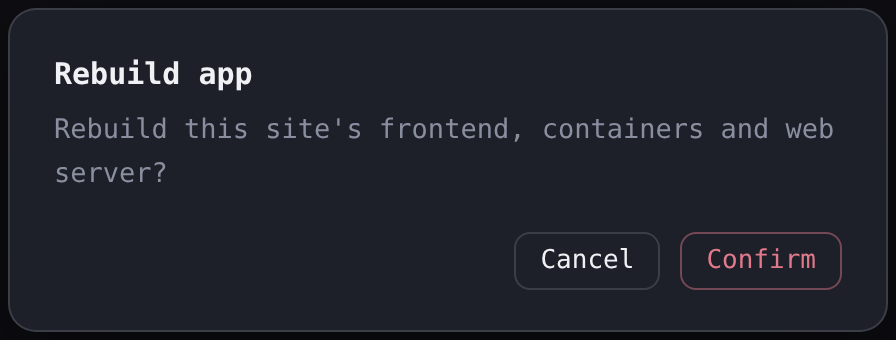

# Settings

The Settings tab edits the site's settings files and holds the dataset roles and maintenance panels.

## Panel order

The **Configuration** editor spans the tab first, then the **Datasets** panel, **Backups**, **Rebuild** and **Worker provisioning**, and **Feature switches** last.

## Configuration editor

The **Configuration** panel edits the values of one settings file at a time. It opens with no file selected and shows **Select a file to edit its keys.** The list names the subsystem files and the environment file. A subsystem file holds non-secret settings, including site and worker identity, and the environment file holds credentials.

1. Select a file in the list.
2. Edit the value in the text field beside its key.
3. Select the save control, which names the open file (**Save config/web.toml** for the web settings file).

Every key of the open file appears with its value. A string value edits its own contents, and a number, on/off value, list or table edits JSON text. The save control is disabled while the file has no changed value.

Before the first write, the panel checks every changed value. A change to a number, on/off value, list or table that is not valid JSON stops the save before any key is written, and the notice names the key.

The save writes the changed keys one at a time in the order the file lists them. If one key is refused, the keys before it are saved and the rest are unsaved. The panel shows the failure and states how many of the changed keys are saved. Selecting the save control again retries the unsaved keys. When every changed key is saved, the panel states **All changed keys are saved.**

The affected process reads a saved change when it restarts. The open file reads again automatically while it has no changed value, so its values follow the file.

> [!WARNING]
> Selecting another file clears the unsaved edits of the open file.

The [Configuration](/docs/backend/configuration.md) page describes how the settings files compose and how a saved value reaches a process.

## Datasets

The **Datasets** panel holds both dataset roles, the retained inventory and the copy, migration and deletion actions. [Dataset roles](/docs/operations/admin-console/dataset-roles.md) describes the roles, the actions and their confirmations.

## Backups

The **Backups** panel lists one row per backup file, with its name, its modification time in UTC to the whole minute and its size. A successful read that finds no file shows **No backup file is listed.**

**Delete** opens the **Delete backup** dialog, which names the exact file. **Cancel**, Escape and a click outside the dialog close it and change nothing. **Confirm** removes the file and reloads the listing. A failed deletion leaves the row and shows the failure in the panel.

## Rebuild

The **Rebuild** panel lists the four steps of an app rebuild in order: **Build the site frontend**, **Recreate the database and embedding containers**, **Restart the site's web server** and **Verify the web server's loopback bind**. The web server status in **Dashboard** reads its unit from the same manager. [Setup and preflight](/docs/operations/setup-and-preflight.md#the-two-rebuild-scopes) states what each step runs and the manager the restart uses.

**Rebuild app** asks for confirmation first. It runs the four steps and shows the steps it ran and the bind it verified.

**Rebuild admin panel** asks for confirmation first, and the dialog states that it signs all operators out. It builds the console, and the administration backend then restarts. The console returns to the sign-in screen with **The admin panel is restarting. Sign in again.**

While either action runs, the panel shows **Running…** and disables both actions. A failed rebuild shows its failure in the panel. A restart step without the grant fails the rebuild, and the panel shows the failure. A completed administration rebuild ends every administration session, and a failed administration build queues no restart and leaves the console signed in.

## Worker provisioning

The **Worker provisioning** panel sets up or updates the worker.

1. Enter the **origin branch**.
2. Leave **code only** off for a full setup, or switch it on to update the code and its locked dependencies alone.
3. Select **Worker setup or update**.

The origin branch input starts empty. **Worker setup or update** is disabled until a branch is entered, and the panel shows **Enter an origin branch before the setup.** The confirmation names the branch, and **Cancel**, Escape and a click outside the dialog close it and change nothing.

A full setup also performs the worker bootstrap and prepares its resources. The report shows the code branch, the code revision, whether the server origin differs, whether the resources are ready and, when they are not, the missing resources. With **code only** on, the setup reports the code facts and shows resource readiness as **unknown**.

**Preflight** compares this checkout's Git origin with the configured origin, reports whether this checkout differs from its origin branch, and reads the worker's code branch and revision, together with the worker's prepared resources. It sends nothing on its own, shows a preflight report from the worker when selected, and holds that report separate from a setup report. The panel's marker says **manual**.

[Worker sessions](/docs/operations/worker-sessions.md) describes the worker session that the stages run.

## Feature switches

The **Feature switches** panel holds the two switches that decide which features the site serves. **Inference features** covers the inferred toggle, inferred tags and Discover. **Embedding features** covers recommendations, the semantic tier and the vector meters.

Each switch writes its setting when selected. A successful write shows the written position and adds a notice above the panels that names the setting and its state and states that a rebuild or restart applies it to serving. A refused write shows the position the file holds and the failure. A value the file does not report as on or off shows **unknown** in place of the switch.

> [!IMPORTANT]
> A saved switch changes serving only after the site's web server is rebuilt or restarted.

## When a read fails

Each panel shows the failure of its own read. A failed read leaves the last successful report and its marker in place, and the next successful read clears the failure. A panel that has no successful read shows the failure. A failed save, deletion, rebuild or worker action shows its failure in its own panel.

The [Administration console](/docs/operations/admin-console/README.md) describes the sign-in, the header, the confirmation dialog and the read markers.
